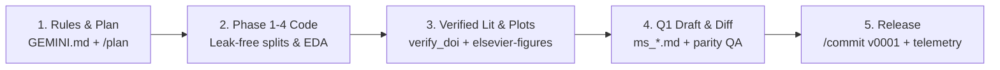

# AI-Augmented Q1 Scientific Production — Interactive Class

> [!NOTE]
> **GitHub-Native Course View:** This `class/README.md` renders natively on GitHub (with Mermaid diagrams, collapsible panels, syntax-highlighted diffs, copyable prompts, and interactive checklists). For the standalone offline single-page web app (dark/light mode toggle, `localStorage` persistence), open [class/index.html](./index.html) locally or host it via GitHub Pages.

Using AI agents inside a blank chat window produces hallucinated DOIs, inconsistent notation, leaked test splits, and non-compliant plots. Governing an AI agent with a structured repository (`GEMINI.md`, domain rules in `.agents/rules/`, and deterministic Python QA scripts in `.agents/skills/`) turns it into a **verifiable research co-pilot**.

## Table of Contents

1. [Module 1 — The AI-Augmented Scientific Workflow](#module-1--the-ai-augmented-scientific-workflow)
2. [Module 2 — Repository Architecture & Reproducibility](#module-2--repository-architecture--reproducibility)
3. [Module 3 — Anti-Hallucination Literature Research](#module-3--anti-hallucination-literature-research)
4. [Module 4 — Q1 Manuscript Drafting & Word-Diff QA](#module-4--q1-manuscript-drafting--word-diff-qa)
5. [Module 5 — Publication-Grade Figures (Elsevier Standards)](#module-5--publication-grade-figures-elsevier-standards)
6. [Module 6 — Documentation Sync & Verbose Git Telemetry](#module-6--documentation-sync--verbose-git-telemetry)
7. [Module 7 — Hands-On Prompt Playbook & Q1 Submission Checklist](#module-7--hands-on-prompt-playbook--q1-submission-checklist)

---

## Module 1 — The AI-Augmented Scientific Workflow

### Architecture Over Ad-Hoc Prompting

| Dimension | Ad-Hoc Chatting (Fragile) | Skill-Governed Repository (Reproducible) |
| :--- | :--- | :--- |
| **Citations** | Invents plausible DOIs or blends author years from memory | Verifies every DOI live via Crossref API (`verify_doi.py`) before drafting |
| **Statistics & Splits** | Risks leaking held-out test metrics into tuning or prose | `GEMINI.md` locks strict `train` / `validation` / `test` separation |
| **Manuscript Prose** | Repeats table matrices verbatim; drifts across turns | `q1-article` & `manuscript_qa` enforce concise IMRaD prose + Word parity |
| **Publication Figures** | Arbitrary sizes, embedded global titles, low-DPI PNGs | `elsevier-figures` + `audit_figures.py` verify 90/140/190 mm & 600 DPI TIFF |

### End-to-End Scientific Production Pipeline



---

## Module 2 — Repository Architecture & Reproducibility

Expand each component below to inspect its methodological role and how AI agents interact with it:

<details open>
<summary><strong>1. <code>GEMINI.md</code> — Project Constitution</strong></summary>

Loaded automatically into agent context. Defines the 4-phase research order (`Phase 1: Data` -> `Phase 2: Modeling` -> `Phase 3: Inference` -> `Phase 4: Analytics`), forbids train/validation/test leakage, forbids hardcoding physical thresholds outside `.env`, and requires written plans before major code or manuscript edits.

</details>

<details>
<summary><strong>2. <code>.agents/rules/</code> — Guardrails That Never Drift</strong></summary>

Three focused policy files:
- [literature.md](../.agents/rules/literature.md): Live DOI verification, Q1 journal priority, APA/Elsevier sorting rules.
- [visualization.md](../.agents/rules/visualization.md): 90/140/190 mm Elsevier widths, zero global in-plot titles, Okabe-Ito palette, 600 DPI RGB LZW `.tiff` + vector `.pdf` + 300 DPI `.png`.
- [git_workflow.md](../.agents/rules/git_workflow.md): Sequential `v0001 - <summary>` verbose commits and automated CSV/DOCX telemetry sync.

</details>

<details>
<summary><strong>3. <code>.agents/skills/</code> — 6 Deterministic Skills &amp; Python QA Scripts</strong></summary>

- `manuscript_qa`: [validate_manuscript.py](../.agents/skills/manuscript_qa/scripts/validate_manuscript.py) (links, sequential captions, citations, punctuation hygiene, Word-diff parity, 1-to-1 reference checks).
- `q1-article`: [manuscript_metrics.py](../.agents/skills/q1-article/scripts/manuscript_metrics.py) (pure prose vs. table word counts, abstract <= 250 words, highlights <= 85 chars, captions <= 45 words).
- `elsevier-figures`: [audit_figures.py](../.agents/skills/elsevier-figures/scripts/audit_figures.py) (column width mm, DPI, RGB mode, LZW TIFF, PDF Type 3 bitmap font scan).
- `scientific_literature_research`: [verify_doi.py](../.agents/skills/scientific_literature_research/scripts/verify_doi.py) (Crossref API DOI verification -> APA 7th).
- `commit`: [sync_telemetry.py](../.agents/skills/commit/scripts/sync_telemetry.py).
- `update-documentation`: [audit_docs_sync.py](../.agents/skills/update-documentation/scripts/audit_docs_sync.py).

</details>

<details>
<summary><strong>4. <code>docs/manuscript/sections/ms_*.md</code> — Canonical Manuscript Sections</strong></summary>

Modular section files (`ms_0` Title/Abstract/Highlights, `ms_1` Introduction, `ms_2` Materials & Methods, `ms_3` Results & Discussion, `ms_4` Conclusions, `ms_S1` Supplementary Material). Every file ends with `---` and a verified 1-to-1 DOI bibliography.

</details>

<details>
<summary><strong>5. <code>docs/manuscript/sections/highlighted/*_HIGHLIGHTED.md</code> — Word-Diff Guides</strong></summary>

Human-friendly Microsoft Word edit guides showing red strikethrough deletions (`<del>`) and yellow highlight insertions (`<mark>`). Stripping `<del>` blocks matches canonical `ms_*.md` character-for-character.

</details>

<details>
<summary><strong>6. <code>docs/references/master_literature_review.txt</code> — Verified Literature Registry</strong></summary>

Single source of truth for Q1 peer-reviewed references with authenticated Crossref/OpenAlex DOIs formatted in APA 7th style.

</details>

<details>
<summary><strong>7. <code>src/project_pkg/</code> &amp; <code>notebooks/</code> — Reproducible Code Pipeline</strong></summary>

Reusable Python plotting/I/O utilities paired with chronologically numbered Phase 0-4 Jupyter notebooks sharing the identical local/Google Colab bootstrap cell in [.agents/AGENTS.md](../.agents/AGENTS.md).

</details>

> [!IMPORTANT]
> **Dataset Hygiene Golden Rule:** Fit scalers, encoders, imputers, and hyperparameter searches strictly on `train`; compare and rank candidates on `validation`; touch `test` **once** after all modeling decisions are frozen.

---

## Module 3 — Anti-Hallucination Literature Research

LLMs frequently blend author lists, publication years, and DOIs when generating citations from memory. Under `.agents/rules/literature.md`, every paper must be verified live before entering any prose file.

**Verify a single DOI or search Crossref from the terminal:**

```powershell
python .agents/skills/scientific_literature_research/scripts/verify_doi.py --doi 10.1016/j.jhydrol.2009.08.003
```

**Copyable Prompt Recipe — Q1 Literature Discovery:**

```text
Using scientific_literature_research, find 4 peer-reviewed Q1 journal articles (last 5 years) comparing tree ensembles against spatial baselines for sparse environmental networks. Verify every DOI via verify_doi.py, exclude technical reports and preprints, format in APA 7th, and append them to docs/references/master_literature_review.txt.
```

---

## Module 4 — Q1 Manuscript Drafting & Word-Diff QA

Canonical sections (`ms_*.md`) enforce Q1 conciseness, formula-free running prose (equations remain in numbered display blocks), and 1-to-1 end-of-section DOI parity. Inspect the interactive before/after revision steps below:

<details open>
<summary><strong>1. Wordy Original Draft (Verbose + Code Tokens + Unsorted Citations)</strong></summary>

> In the context of this study, it should be noted that Table 2 shows XGBRegressor obtained MAE = 1.42 mm (vs. 1.62 mm for IDW), while GradientBoostingRegressor obtained 1.44 mm and RandomForestRegressor got 1.51 mm across n_months >= 3 stations, which improves performance by 12.4% (Dubreuil et al., 2018, 2017).

</details>

<details>
<summary><strong>2. GitHub Diff View (And Word Red/Yellow Revision Guide Equivalent)</strong></summary>

```diff
- In the context of this study, it should be noted that Table 2 shows XGBRegressor obtained MAE = 1.42 mm (vs. 1.62 mm for IDW), while GradientBoostingRegressor obtained 1.44 mm and RandomForestRegressor got 1.51 mm across n_months >= 3 stations, which improves performance by 12.4% (Dubreuil et al., 2018, 2017).
+ The leading ensemble (XGB) cuts validation MAE by 12.4% relative to the IDW baseline across retained gauges (Table 2), outperforming GBR and RF (Dubreuil et al., 2017, 2018).
```

Inside `highlighted/*_HIGHLIGHTED.md`, the exact same change is rendered with red strikethrough (`<del>`) and yellow highlight (`<mark>`) so authors can mirror every edit cleanly in Microsoft Word.

</details>

<details>
<summary><strong>3. Tightened Q1 Prose (Canonical <code>ms_*.md</code> Target)</strong></summary>

> The leading ensemble (XGB) cuts validation MAE by 12.4% relative to the IDW baseline across retained gauges (Table 2), outperforming GBR and RF (Dubreuil et al., 2017, 2018).

</details>

**Run Automated Manuscript & Word-Count QA:**

```powershell
python .agents/skills/manuscript_qa/scripts/validate_manuscript.py --strict
python .agents/skills/q1-article/scripts/manuscript_metrics.py docs/manuscript/sections
```

---

## Module 5 — Publication-Grade Figures (Elsevier Standards)

Use [src/project_pkg/utils/plots.py](../src/project_pkg/utils/plots.py) (`apply_elsevier_style()`, `figsize_mm()`, `save_publication_figure()`) so every plot exports cleanly at final print size:

| Specification | Elsevier Target | Automated Check (`audit_figures.py`) |
| :--- | :--- | :--- |
| **Column widths** | `90 mm` (single), `140 mm` (1.5), `190 mm` (double) | Flags deviation > `6 mm` or height > `240 mm` |
| **Raster resolution** | `600 DPI` TIFF (`tiff_lzw`) / `300 DPI` PNG preview | Verifies DPI metadata and LZW compression |
| **Color & typography** | RGB (Okabe-Ito), Arial/Helvetica `7.5-9.5 pt`, `pdf.fonttype = 42` | Flags RGBA alpha channels and PDF Type 3 bitmap fonts |
| **Titles & legends** | Zero `plt.suptitle()` / single-panel `ax.set_title()`; external legends | Verified during mandatory visual inspection |

**Okabe-Ito Colorblind-Safe Categorical Palette:**


**Audit Exported Manuscript Figures:**

```powershell
python .agents/skills/elsevier-figures/scripts/audit_figures.py outputs/figures/manuscript --strict
```

---

## Module 6 — Documentation Sync & Verbose Git Telemetry

Keep code, notebooks, packages, and manuscript artifacts synchronized at every milestone:

| Command / Skill | Automated Action | Verified Outputs |
| :--- | :--- | :--- |
| `/update-documentation` | Runs `audit_docs_sync.py --compile-nbs` | Compiles notebook cells into `docs/telemetry/nb_compiled_phase_*.txt`, checks `requirements.txt == README.md`, verifies `docs/summary/*_summary.txt`, runs `validate_manuscript.py --strict` |
| `/commit` (`v0001 - <summary>`) | Runs pre-commit QA + verbose multi-bullet commit + `sync_telemetry.py` | Creates sequential primary commit (`v{N:04d}`) followed by `v{N+1:04d}` syncing `log_github_lastrun.csv` and `log_github_lastrun.docx` |

---

## Module 7 — Hands-On Prompt Playbook & Q1 Submission Checklist

### Starter Prompt 1 — Plan a Leak-Free Modeling Experiment

```text
/plan Inspect GEMINI.md and Phase 2 notebooks. Design a new baseline comparison strictly using train/validation splits without touching held-out test data. Wait for my approval before writing code.
```

### Starter Prompt 2 — Condense a Manuscript Section & Sync Word Diffs

```text
Use q1-article and manuscript_qa on docs/manuscript/sections/ms_3_Results_and_Discussion.md: cut narrative table repetition by 20%, keep every exact statistic, maintain 1-to-1 verified DOI references, update highlighted/ms_3_Results_and_Discussion_HIGHLIGHTED.md, and pass validate_manuscript.py --strict.
```

### Pre-Submission Readiness Checklist

- [ ] **1. Zero Data Leakage:** Preprocessing, scaling, and Optuna/CV tuning ran strictly on development partitions; test set evaluated once.
- [ ] **2. Live-Verified DOIs:** Every citation passed `verify_doi.py` or Crossref/OpenAlex lookup and uses Q1 peer-reviewed sources first.
- [ ] **3. Word Limits Met:** Abstract <= 250 words, 3-5 Highlights <= 85 characters, figure captions <= 45 words (`manuscript_metrics.py`).
- [ ] **4. Strict Parity Passed:** `validate_manuscript.py --strict` exits 0 with zero citation, link, dash, or Word-diff parity errors.
- [ ] **5. Elsevier Figure Audit Passed:** `audit_figures.py --strict` confirms 90/140/190 mm widths, 600 DPI RGB LZW TIFF, and vector PDF without Type 3 fonts.
- [ ] **6. Visual Inspection Done:** Every rendered figure inspected visually for clipped tick labels, external legends, and readable 8-9 pt typography.
- [ ] **7. Documentation & Telemetry Synced:** `audit_docs_sync.py --compile-nbs` passed and sequential `/commit` telemetry is updated.

> [!TIP]
> **Want to host the standalone interactive HTML version live on GitHub?** Once you initialize Git and push to GitHub, open **Settings &rarr; Pages**, select **Deploy from a branch** (`main` / `root`), and visit `https://<username>.github.io/<repo>/class/index.html`.
